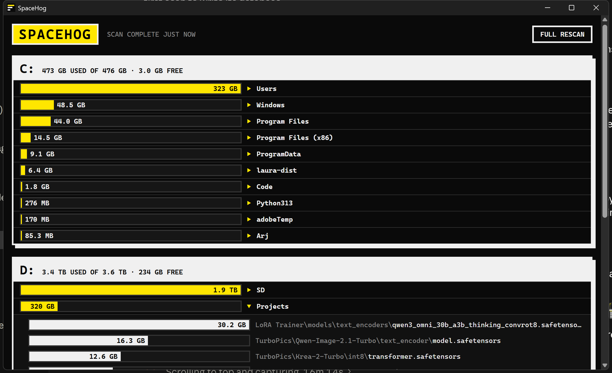

# SpaceHog

**See what eats your disk. Fast.**

A tiny, portable, brutalist disk-usage viewer for Windows. One 4.5 MB executable, no installer, no settings, nothing written outside its own folder.



## What it does

- One section per fixed drive (C:, D:, …) listing the **10 biggest top-level folders**, each with a bar showing its relative size.
- The size sits **inside the bar** when it fits, **to its right** when it doesn't.
- **Click a folder** to unroll the **10 largest files** anywhere inside it.
- **Right-click** a folder or file for *Show in Explorer* or *Delete…* (asks for confirmation, then moves it to the **Recycle Bin**, so it's undoable).
- Deleting updates the display and totals instantly (no rescan); each drive header also shows how much was **scanned**.
- An **About** dialog, because credit where due.
- Dark mode only. Sharp corners. No animations.

## Speed

Drives are scanned concurrently by a Rust work-stealing thread pool (oversubscribed, since directory walking is I/O-bound). A full scan of ~4 TB / two drives takes under a minute on an NVMe/SSD machine; later launches show the stored results instantly and refresh in the background.

## Portable by design

| File (next to `SpaceHog.exe`) | Purpose |
|---|---|
| `spacehog.db` | LZ4-compressed scan results (a few tens of MB) |
| `spacehog.webview/` | WebView2 cache, kept here instead of `%LOCALAPPDATA%`; cleaned up on exit (or next launch) |

Nothing is written anywhere else. Delete the files and the app is gone.

## Incremental rescans, and their limit

On launch, SpaceHog reuses the stored data and only re-reads directories whose **modification time changed**. This is fast, but NTFS directory mtimes change only when entries are added, removed or renamed, **not when an existing file grows**. So a log or VM disk that grows in place may be stale until the next full scan. SpaceHog therefore forces a full scan every 7 days, and the **FULL RESCAN** button does one on demand.

## How sizes are counted

- Size on disk, not logical size: OneDrive *online-only* placeholders count as 0 and sparse/compressed files use their allocated size.
- Symlinks and junctions are not followed (no loops, no double counting).
- Hard links are counted once per link (so "scanned" can exceed "used", notably on C: because of `WinSxS`).
- The Recycle Bin keeps deleted data on disk until emptied, so the drive's "used" figure from Windows only drops after you empty it; "scanned" drops immediately.
- Run without admin rights, protected folders (e.g. `System Volume Information`) can't be read and are skipped.

## Build

Requires [Rust](https://rustup.rs) and the WebView2 runtime (included in Windows 11). No Node, no bundler: the UI is plain HTML/CSS/JS in `ui/`.

```
cd src-tauri
cargo build --release
```

The portable executable is `src-tauri/target/release/spacehog.exe`. Prebuilt Windows x64 binaries are on the [Releases](https://github.com/DexterLagan/SpaceHog/releases) page (unsigned, so SmartScreen may ask you to confirm on first run).

## License

[MIT](LICENSE) © 2026 Dexter Santucci
